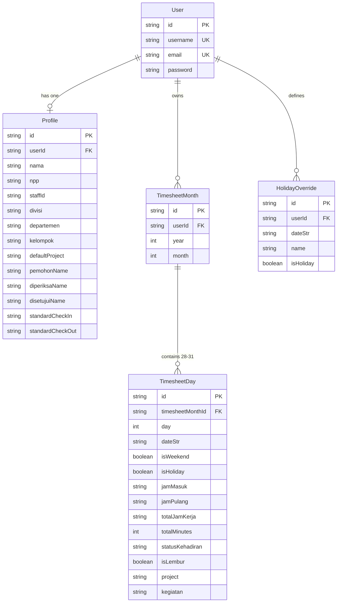

# 📋 T3racker — Project Master Plan & Roadmap

> **Time & Overtime Tracking with Automated Official Document Generation**  
> Tailored for corporate personnel, contractors, and development teams within the **BNI (Bank Negara Indonesia)** and **SDD** enterprise ecosystem.

---

## 📌 1. Project Overview & Vision

### 1.1 Problem Statement
At the end of every calendar month, personnel and contractors face time-consuming administrative work:
- Compiling daily check-in and check-out logs into formatted spreadsheets.
- Calculating complex overtime hours based on distinct rules for workdays vs. weekends/holidays.
- Generating multiple official corporate submission documents with specific layout, font, signature, and formatting constraints:
  1. **Absensi Manual** (`.xlsx`)
  2. **Surat Perintah Kerja Lembur (SPKL) SDD** (`.docx`)
  3. **Form Lembur BNI** (`.docx`)

### 1.2 Solution & Vision
**T3racker** serves as an intelligent single source of truth. Users maintain their monthly work logs with quick-fill presets and inline spreadsheet editing. The application dynamically evaluates corporate attendance and overtime policies, visualizes monthly metrics, and generates pixel-perfect, ready-to-sign official documents in one click.

---

## 🏗️ 2. Architecture & Tech Stack

```text
┌─────────────────────────────────────────────────────────────┐
│                       Client (Browser)                      │
│   Next.js 16 (React 19) + Tailwind CSS v4 + Lucide Icons    │
│   Inline Matrix Table, KPI Cards, Batch Modals              │
└───────────────▲─────────────────────────────┬───────────────┘
                │                             │
        HTTP / JSON APIs                Binary Stream Downloads
                │                             │
┌───────────────┴─────────────────────────────▼───────────────┐
│                      Next.js API Routes                     │
│  • /api/auth       • /api/timesheet      • /api/profile     │
│  • /api/holidays   • /api/export/excel   • /api/export/docx │
└───────────────▲─────────────────────────────┬───────────────┘
                │                             │
      Prisma ORM (SQLite)           Document Generators
                │                   • ExcelJS (Worksheet Engine)
┌───────────────┴─────────────┐     • docx (Word Processing)
│       SQLite Database       │
│  Users, Profiles, Months,   │
│  Days, Holiday Overrides    │
└─────────────────────────────┘
```

| Layer | Component | Description |
| :--- | :--- | :--- |
| **Frontend** | Next.js 16.3 (App Router), React 19, TypeScript | Server Components & Client interactive table matrix |
| **Styling** | Tailwind CSS v4, Lucide React Icons | Modern corporate styling, responsive design system |
| **Backend** | Next.js API Routes (`/src/app/api/*`) | REST endpoints for auth, timesheets, profile, and exports |
| **Database** | SQLite via Prisma 6.19 ORM | Lightweight, zero-config relational database |
| **Authentication**| JWT sessions via `jose` & `bcryptjs` | HTTP-only cookie-based authentication (`t3racker_session`) |
| **Export Engines**| `exceljs` & `docx` | Direct binary stream generation for `.xlsx` and `.docx` |

---

## 🗄️ 3. Data Model & Schema

Located at: [`prisma/schema.prisma`](file:///c:/SDD/Personal%20Project/T3racker/prisma/schema.prisma)



---

## ⚡ 4. Core Business Rules & Calculations

Reference: [`src/lib/time-calc.ts`](file:///c:/SDD/Personal%20Project/T3racker/src/lib/time-calc.ts)

1. **Standard Shift Definition**:
   - Default In: `08:30` (510 minutes from midnight).
   - Default Out: `17:00` (1020 minutes from midnight).
   - Standard Duration: `8.5 hours` (510 minutes).
2. **Workday Overtime Rule**:
   - Overtime is flagged (`isLembur = true`) when either:
     - Total duration $\ge$ Standard Duration + 3.0 Hours (11h 30m / 690 minutes), **OR**
     - Check-out time $\ge$ Standard Out + 3.0 Hours (after `20:00`).
3. **Weekend & Holiday Overtime Rule**:
   - Overtime is flagged when working duration $\ge$ `8.0 hours` (480 minutes).
4. **Attendance Codes**:
   - `H`: Present (*Hadir*)
   - `C`: Leave (*Cuti*)
   - `I`: Permission (*Izin*)
   - `S`: Sick (*Sakit*)

---

## 🗺️ 5. Implementation Roadmap

### ✅ Phase 1: Core Foundation & MVP (Completed)
- [x] Next.js 16 + React 19 + TypeScript base architecture.
- [x] Prisma ORM configuration with SQLite.
- [x] JWT cookie session authentication & registration flow.
- [x] Interactive monthly matrix table with dynamic day count.
- [x] National holiday engine (2025–2027) with custom override system.
- [x] Real-time hours calculation & automated overtime classification.
- [x] Debounced auto-save directly to SQLite.
- [x] Live attendance & overtime KPI summary cards.
- [x] Official export generation:
  - [x] Excel Absensi Manual (`.xlsx`) matching BNI/SDD layout.
  - [x] SPKL SDD (`.docx`) with approval matrices and task lists.
  - [x] Form Lembur BNI (`.docx`) with multi-signatory structure.
- [x] Initial seed script replicating August 2026 production timesheet.

---

### ✅ Phase 2: User-Friendly Monthly Calendar & Header Form (Completed)
- [x] **Employee & Organization Header Form** ([`EmployeeHeaderForm.tsx`](file:///c:/SDD/Personal%20Project/T3racker/src/components/EmployeeHeaderForm.tsx)):
  - 8 synchronized fields: Nama, NPP, Divisi, Departemen, Kelompok, Periode (Month/Year), Atasan Langsung, and Department Head.
  - Debounced auto-save to `/api/profile` so changes instantly flow to official export signatures.
- [x] **Monthly Calendar Grid** ([`TimesheetCalendar.tsx`](file:///c:/SDD/Personal%20Project/T3racker/src/components/TimesheetCalendar.tsx)):
  - 7-column calendar matrix (Senin to Minggu) matching Indonesian corporate weeks.
  - Interactive day tiles showing date number, national holidays, attendance status pills (H, C, I, S), working hours, overtime flame tag 🔥, and task previews.
  - Single-click quick fill on hover for empty workdays.
- [x] **Revamped Day Edit Modal** ([`DayEditModal.tsx`](file:///c:/SDD/Personal%20Project/T3racker/src/components/DayEditModal.tsx)):
  - Direct checkboxes / selector pills for attendance status (`H`, `C`, `I`, `S`).
  - Inputs for `jamMasuk`, `jamKeluar`, `Project`, `Project Code`, `AP Fitur`, and `Kegiatan` textarea.
  - Previous / Next day shortcut buttons to log consecutive days rapidly.

---

### ✅ Phase 2.1: UI Streamlining & Nitpick Refinements (Completed)
- [x] **Consolidate Month Selection**:
  - Removed duplicate month navigation from app header ([`Navbar.tsx`](file:///c:/SDD/Personal%20Project/T3racker/src/components/Navbar.tsx)).
  - Fixed width of the month/year label container (`w-36 sm:w-40 text-center`) in [`EmployeeHeaderForm.tsx`](file:///c:/SDD/Personal%20Project/T3racker/src/components/EmployeeHeaderForm.tsx) so `<` and `>` buttons remain in an exact, static spatial position for effortless consecutive clicking without mouse readjustment.
  - Disabled the "Periode" field in the form body so it serves purely as a read-only indicator of the active period.
- [x] **Remove Table Spreadsheet View**:
  - Eliminated the spreadsheet table toggle and unused table matrix view to keep the UI clean, streamlined, and 100% calendar-focused.
- [x] **Fix Status Kehadiran Click Hitbox in Day Edit Modal**:
  - Replaced `<label>` click-bubbling behavior with robust button-based toggling so clicking anywhere on the status card or checkbox reliably toggles the status (`H`, `C`, `I`, `S`).

---

### ✅ Phase 2.2: Multi-Vendor Asset Infrastructure (Completed)
- [x] **Upscaled & Uniform Vendor Asset Pipeline**:
  - Generated high-resolution, uniform icon assets with 100% transparent backgrounds for all 5 BNI contractor vendors in [`public/vendors/`](file:///c:/SDD/Personal%20Project/T3racker/public/vendors/):
    1. **SDD** (`sdd.png`, `sdd-wide.png`, `sdd-1024.png`)
    2. **Iglo** (`iglo.png`, `iglo-wide.png`, `iglo-1024.png`)
    3. **NTT DATA** (`ntt-data.png`, `ntt-data-wide.png`, `ntt-data-1024.png`)
    4. **ADIDATA** (`adidata.png`, `adidata-wide.png`, `adidata-1024.png`)
    5. **MII (Mitra Integrasi Informatika)** (`mii.png`, `mii-wide.png`, `mii-1024.png`)
  - Formats provided: Uniform Square (`512x512` & `1024x1024`) with optical padding for UI selectors/avatars, and Wide Banner (`800x300`) for document letterheads.
- [x] **Vendor Configuration Module** ([`src/lib/vendors.ts`](file:///c:/SDD/Personal%20Project/T3racker/src/lib/vendors.ts)):
  - Centralized TypeScript configuration with legal names, brand colors, default divisions, tagline, SPKL form codes, and asset paths.

---

### ✅ Phase 2.3: Vendor Selection & Dynamic Document Templates (Completed)
- [x] **Settings Modal Vendor Selector** ([`SettingsModal.tsx`](file:///c:/SDD/Personal%20Project/T3racker/src/components/SettingsModal.tsx)):
  - Added interactive visual 5-vendor selection card grid with official logos and active checkmarks.
  - Persisted to database `Profile.vendor` column via `/api/profile`.
- [x] **Employee Header Form Vendor Integration** ([`EmployeeHeaderForm.tsx`](file:///c:/SDD/Personal%20Project/T3racker/src/components/EmployeeHeaderForm.tsx)):
  - Display active vendor badge & logo in the header accordion.
  - Added interactive 5-vendor quick-switch bar with official logo icons directly above form fields.
  - Auto-saves changes debounced into user profile.
- [x] **Dynamic SPKL Word Generator** ([`docx-sdd-generator.ts`](file:///c:/SDD/Personal%20Project/T3racker/src/lib/docx-sdd-generator.ts)):
  - Dynamically embeds the selected vendor's official wide logo via `ImageRun`.
  - Injects vendor-specific form code (e.g. `SDD-FM-HRD-04-01 Rev. 1`, `IGLO-FM-HRD-04-01 Rev. 1`, `NTTD-FM-HRD-04-01 Rev. 1`, etc.).
  - Customizes letterhead title with company legal entity name (e.g. `PT. SWADHARMA DUTA DATA`, `PT. INDODEV NIAGA INTERNET`, `PT. NTT DATA INDONESIA`, `PT. ADIDATA INFORMATIKA`, `PT. MITRA INTEGRASI INFORMATIKA`).
  - Formats export filename dynamically: `SPKL_{Vendor}_{Name}_{Month}_{Year}.docx`.
- [x] **Dynamic Excel Timesheet Generator** ([`excel-generator.ts`](file:///c:/SDD/Personal%20Project/T3racker/src/lib/excel-generator.ts)):
  - Dynamically embeds the selected vendor's official wide logo into cells A1..B2.
  - Tailors brand headers and taglines according to the chosen vendor.
  - Formats export filename dynamically: `Absensi_Manual_{Vendor}_{Name}_{Month}_{Year}.xlsx`.
- [x] **Header & Calendar UI Synchronization** ([`Navbar.tsx`](file:///c:/SDD/Personal%20Project/T3racker/src/components/Navbar.tsx) & [`TimesheetCalendar.tsx`](file:///c:/SDD/Personal%20Project/T3racker/src/components/TimesheetCalendar.tsx)):
  - Navbar brand pill dynamically displays active vendor logo and name (`{Vendor} • BNI`).
  - Timesheet calendar export dropdown displays active vendor badge and logo for both Absensi Manual and SPKL downloads.

---

### 🚀 Phase 3: UX Enhancements & Product Refinements (In Progress / Short-Term)
- [ ] **Adaptive Table Scrolling & Freeze Columns**:
  - Freeze Date and Day columns while horizontally scrolling on smaller screens.
- [ ] **Timesheet Edit History & Undo/Redo**:
  - Keep in-memory action history stack so users can revert accidental quick-fills or row resets.
- [ ] **Smart Time Input Masking**:
  - Strict 24-hour time mask (`HH:mm`) with auto-colon formatting on keypress to eliminate syntax errors.
- [ ] **Row Validation & Guardrails**:
  - Warning indicator when check-out is earlier than check-in without overnight flag.
  - High-workload warning if duration exceeds 16 hours in a single shift.
- [ ] **In-Browser Document Preview**:
  - Quick modal preview of the generated document layout before downloading.

---

### 📦 Phase 3: Advanced Features & Integrations (Mid-Term)
- [ ] **Multi-Month & Quarterly Batch Export**:
  - Download all monthly reports for a given quarter as a single `.zip` archive.
- [ ] **PDF Direct Generation**:
  - Generate ready-to-print PDF versions of Absensi Manual and SPKL directly from server without requiring MS Office.
- [ ] **Frequent Activity Auto-Suggestions**:
  - Autocomplete dropdown in "Kegiatan" field derived from past entries and project tickets.
- [ ] **Calendar Integration (Google / Outlook / ICS)**:
  - One-click import from personal calendar to autofill daily activity summaries and meeting logs.
- [ ] **Role-Based Workflow (Reviewer & Approver Mode)**:
  - Add reviewer portal allowing Team Leaders / Dept Heads to view, review, and digitally sign timesheets.

---

### 🏢 Phase 4: Enterprise Scalability & Cloud Deployment (Long-Term)
- [ ] **Multi-Database Support**:
  - Transition option from SQLite to PostgreSQL / MySQL for centralized enterprise deployment.
- [ ] **Corporate SSO Authentication**:
  - OAuth2 / SAML / Active Directory integration for single sign-on corporate logins.
- [ ] **Dockerization & CI/CD**:
  - Containerize application with a multi-stage Dockerfile and automated GitHub Actions test pipeline.
- [ ] **Automated Backup & Restore**:
  - Scheduled automated backups of user timesheet data and database snapshots.

---

## 🛠️ 6. Developer & Operations Guide

### 6.1 Scripts & Commands
```bash
# Start local development server
pnpm dev

# Build production bundle
pnpm build

# Start production server
pnpm start

# Update Prisma schema into database
pnpm prisma:push

# Generate Prisma client types
pnpm prisma:generate

# Run seed script
npx tsx prisma/seed.ts
```

### 6.2 Key Project Files
- **Dashboard UI**: [`src/app/page.tsx`](file:///c:/SDD/Personal%20Project/T3racker/src/app/page.tsx)
- **Table Component**: [`src/components/TimesheetTable.tsx`](file:///c:/SDD/Personal%20Project/T3racker/src/components/TimesheetTable.tsx)
- **Calculation Logic**: [`src/lib/time-calc.ts`](file:///c:/SDD/Personal%20Project/T3racker/src/lib/time-calc.ts)
- **Holiday Engine**: [`src/lib/holidays.ts`](file:///c:/SDD/Personal%20Project/T3racker/src/lib/holidays.ts)
- **Excel Generator**: [`src/lib/excel-generator.ts`](file:///c:/SDD/Personal%20Project/T3racker/src/lib/excel-generator.ts)
- **SDD SPKL Generator**: [`src/lib/docx-sdd-generator.ts`](file:///c:/SDD/Personal%20Project/T3racker/src/lib/docx-sdd-generator.ts)
- **BNI Form Generator**: [`src/lib/docx-bni-generator.ts`](file:///c:/SDD/Personal%20Project/T3racker/src/lib/docx-bni-generator.ts)
- **Database Schema**: [`prisma/schema.prisma`](file:///c:/SDD/Personal%20Project/T3racker/prisma/schema.prisma)
